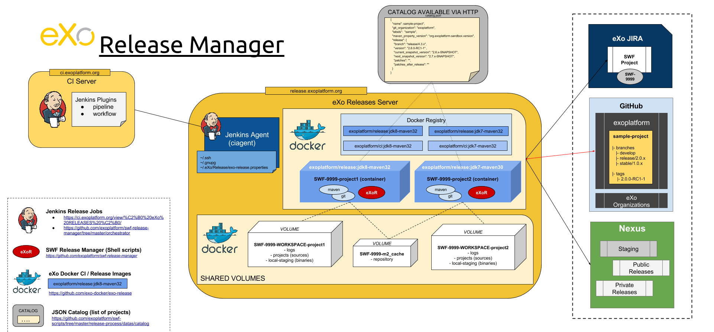

= eXo Release Manager
:toc:
ifdef::env-github[]
:status:
:outfilesuffix: .adoc
:!toc-title:
:caution-caption: :fire:
:important-caption: :exclamation:
:note-caption: :paperclip:
:tip-caption: :bulb:
:warning-caption: :warning:
endif::[]

This repository contains all files about the eXo Release Manager:

* `*app*`: Scripts (bash) used in the *exoplatform/exo-release* Docker image, to release one project

[NOTE]
--
Those scripts are then included in the `eXo Release Docker Images` available at:

* https://github.com/exo-docker/exo-release
--
* `*doc*`: eXo Release Manager Documentation
* `*orchestrator*`: Groovy Scripts used by Jenkins to release/clean several projects with Docker Containers

== Overview

== Development

[source,shell]
----
tests/run.sh               # shellcheck + unit + integration tests
tests/unit.sh              # libraries only (no network, no git remote)
tests/integration.sh       # the real eXoR.sh / setup-env.sh against a local git remote, a fake
                           # Nexus / Tribe / catalog HTTP server and a fake maven
tests/groovy-syntax.sh     # parse the Jenkinsfiles (docker)
----

Requirements: bash, git, jq, openssl, curl, python3, shellcheck. A YAML catalog (see below) also needs
`yq` (https://github.com/mikefarah/yq[mikefarah]) or python3 with PyYAML: *install one of them in the
`exo-release` images* (jq is already there), otherwise only JSON catalogs can be used.

=== Catalog formats

The catalog of a release is a list of projects named after the task: `<TASK_ID>.json`, or `<TASK_ID>.yaml` /
`<TASK_ID>.yml`, downloaded from `CATALOG_BASE_URL` (JSON first). A YAML catalog is converted once into
`catalog.json`, the rest of the process is unchanged. In Jenkins, YAML needs the _Pipeline Utility Steps_ plugin.

=== Logging

* `LOG_LEVEL=DEBUG|INFO|WARN|ERROR` (default `INFO`; `DEBUG=1` still works)
* lines look like `[2026-11-25 21:34:01] [INFO ] message`; everything goes to `$LOGS_DIR/infos.log`,
  warnings and errors also to stderr and `$LOGS_DIR/errors.log`
* the credentials (Nexus, JBoss, GPG, SSH, Tribe, catalog) are masked in the console and in the logs, including the
  output of git and maven

=== Exit codes

`release-start` and `release-continue-from` exit with `100`/`103` (prerequisites: invalid parameter, tag already
exists), `200` (Maven build) or `300` (Nexus staging); anything else is `1`.

== Documentation

* <<doc/user-guide.adoc#,User Guide>>
